# Codex Pulse 设计图归档

归档日期：2026-10-29。保存本次讨论中生成的全部 10 张原始设计图，包含历史方案与后续 Apple 风格方案。PNG 原图未压缩或改写。

设计图使用示例数据。之后对字号、图标、hover、下拉框、搜索入口和圆角的修正以代码及用户后续确认为准。

## 目录

| 设计图 | 内容与版本 |
| --- | --- |
| [重置雷达 · 初版功能布局](01-reset-radar-initial.png) | 历史方案：包含早期服务状态、多区块布局 |
| [重置雷达 · 紧凑标签布局](02-reset-radar-compact-tabs.png) | 历史方案：预测与个人恢复、公告标签布局 |
| [首页 · 中性色方案](03-overview-neutral.png) | 历史方案：后续按反馈改为 Apple 配色 |
| [首页 · Apple 浅色](04-overview-apple-light.png) | 三栏额度卡片、小时图表、最近聊天与日历入口 |
| [Token 明细 · Apple 浅色](05-token-details-apple-light.png) | 后台加载提示、筛选与列表详情分栏 |
| [重置日历 · 方格方案](06-reset-calendar-boxed.png) | 历史方案：后续改为无边框日历 |
| [重置日历 · 无边框方案](07-reset-calendar-borderless.png) | 四项指标、太阳月亮切换、日历与当日记录 |
| [今日用量 · 浅色](08-today-usage-light.png) | 总量、输入输出、小时图表与用量构成 |
| [今日用量 · 深色](09-today-usage-dark.png) | 对应浅色布局的深色方案 |
| [悬浮窗、主题与版本更新](10-floating-theme-update-board.png) | 深浅色悬浮条、悬浮卡片、主题入口与更新状态设计板 |

## 图片预览

### 重置雷达 · 初版功能布局

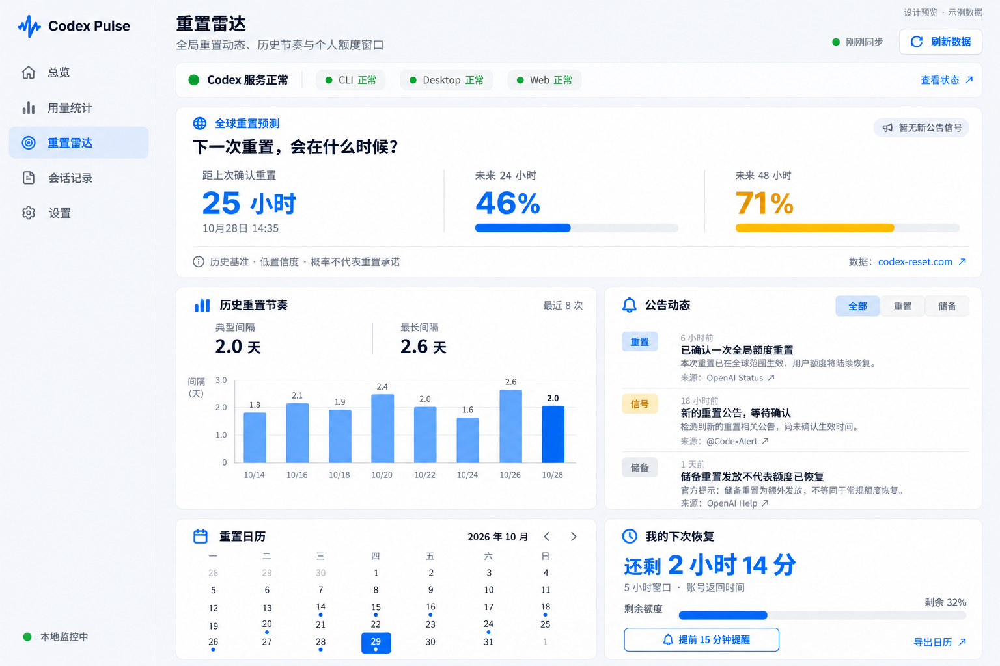

### 重置雷达 · 紧凑标签布局

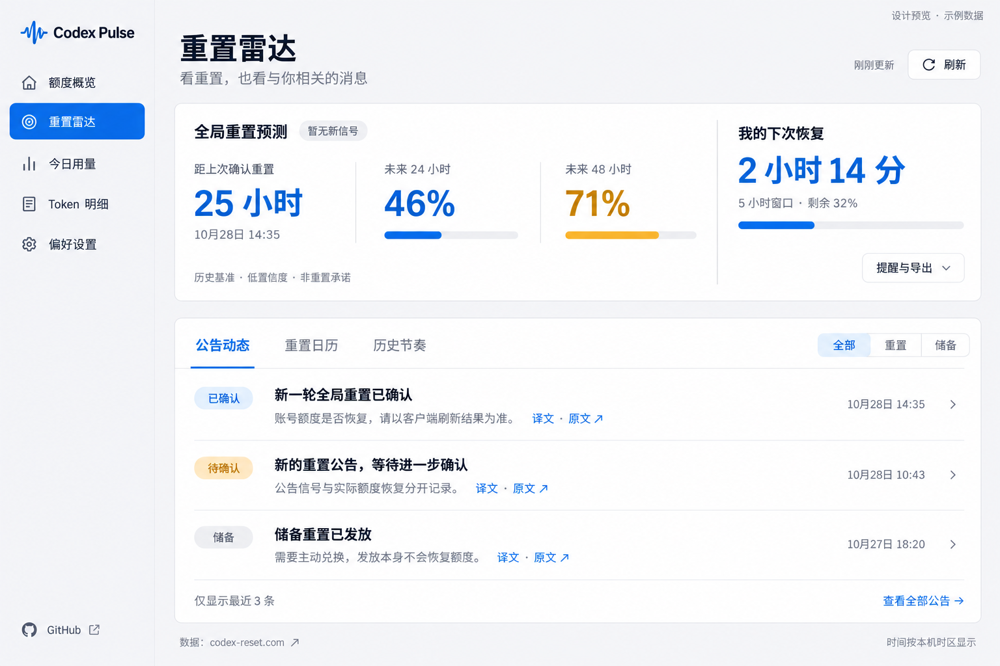

### 首页 · 中性色方案

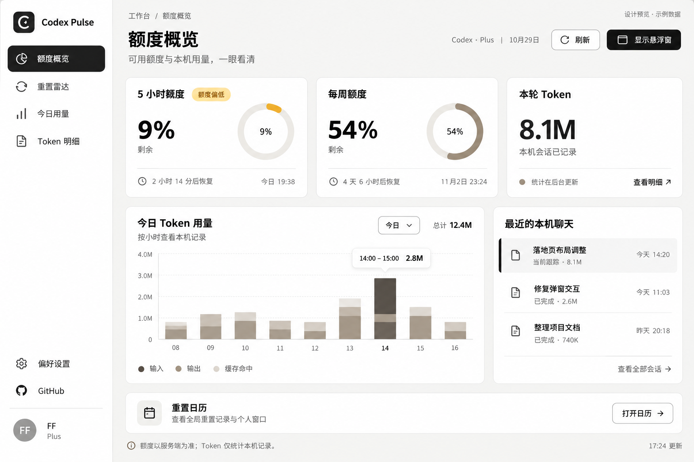

### 首页 · Apple 浅色

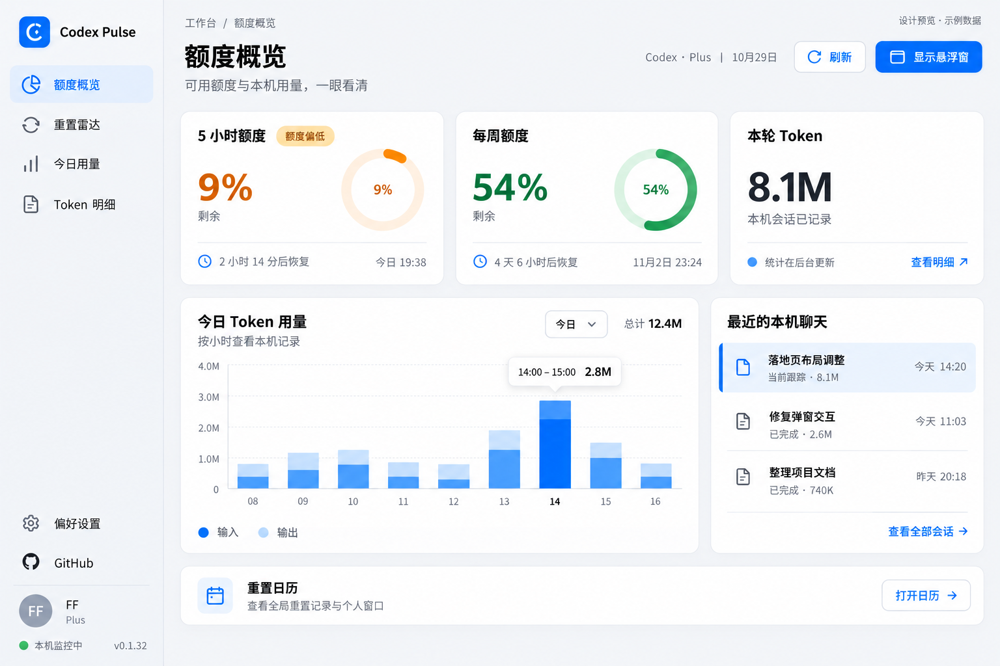

### Token 明细 · Apple 浅色

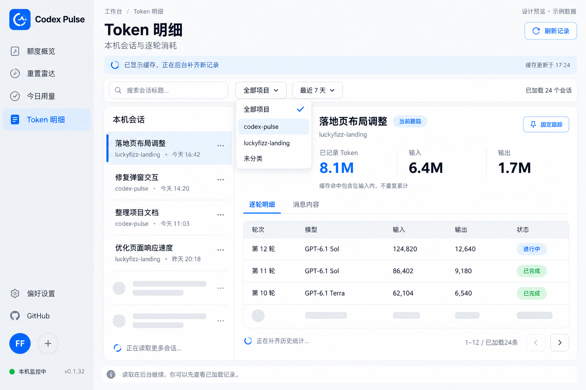

### 重置日历 · 方格方案

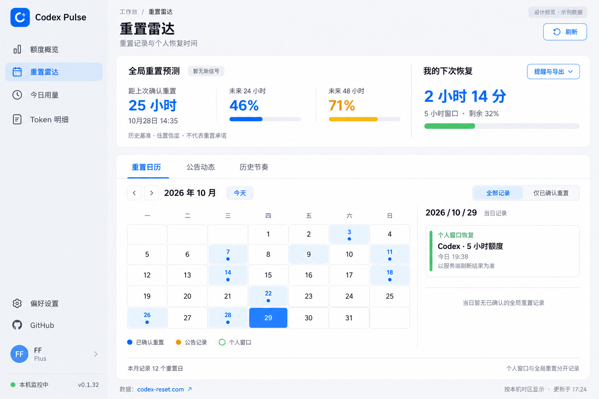

### 重置日历 · 无边框方案

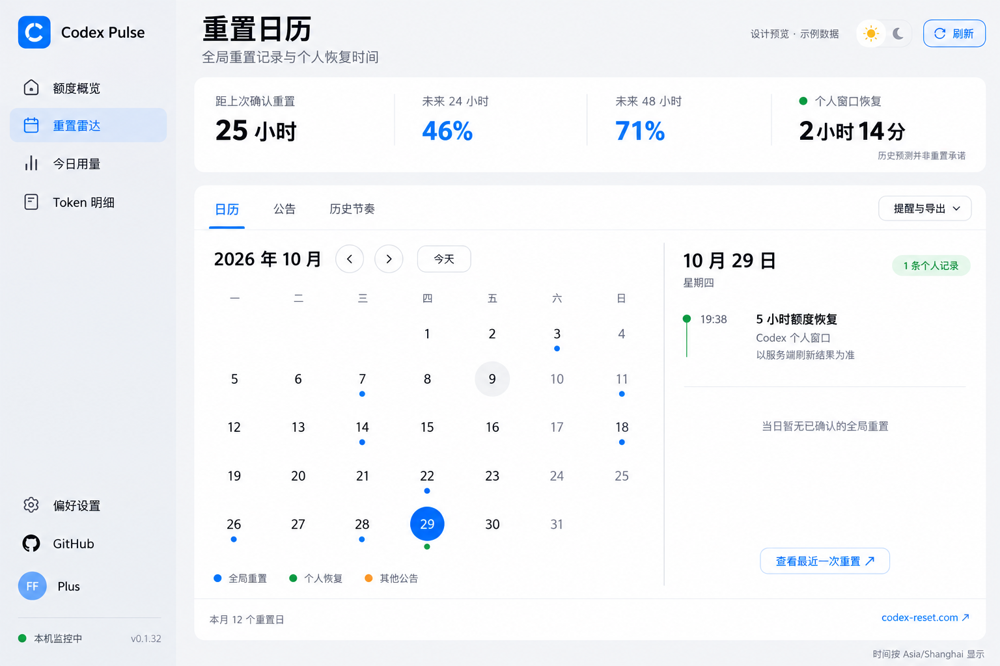

### 今日用量 · 浅色

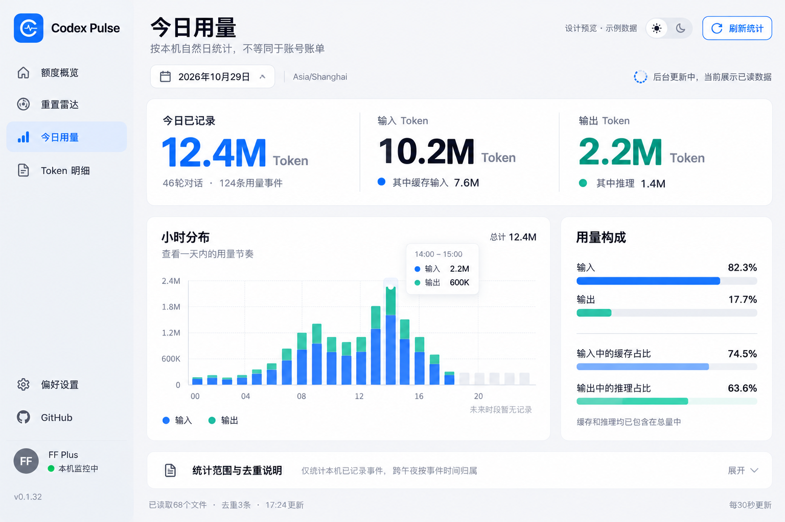

### 今日用量 · 深色

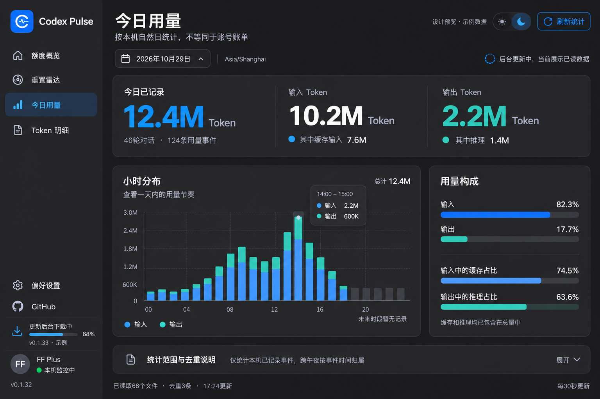

### 悬浮窗、主题与版本更新

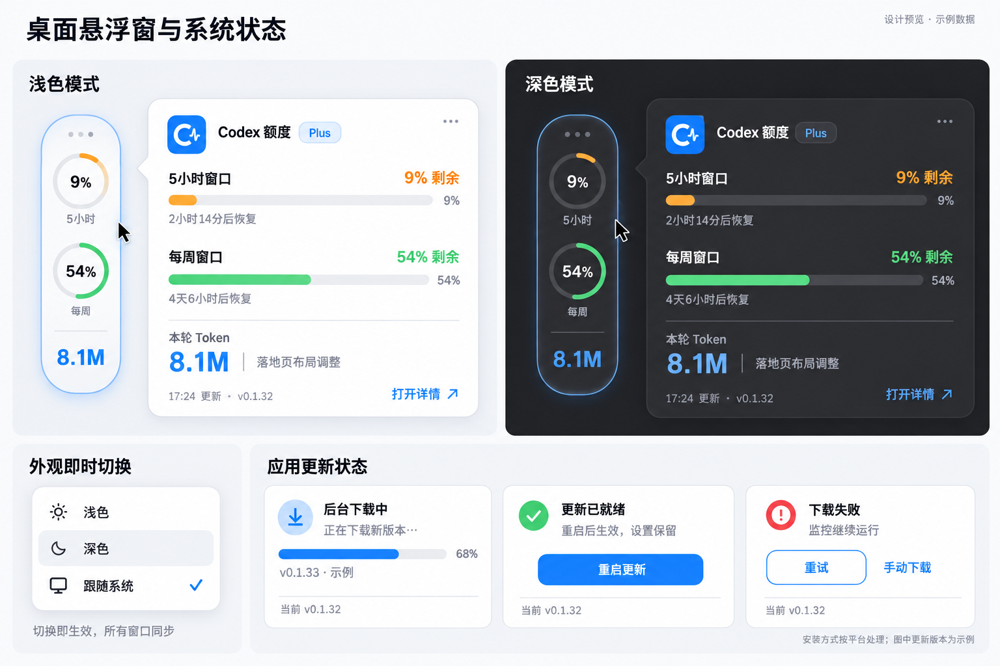

## 来源与校验

[manifest.json](manifest.json) 记录每张图片的原始文件名和 SHA-256，便于核对完整性。归档图存放在文档目录中，不加入桌面应用安装包。

## Logo 历史 · P 字母方案（已弃用）

蓝色柔和渐变、连续圆角轮廓和白色 P 标记。缩减外侧透明留白，Windows ICO 包含 16、20、24、32、40、48、64、96、128、256 像素图层。

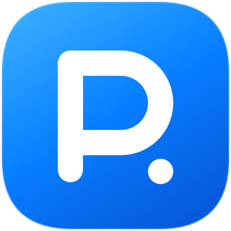

源文件：[标记 SVG](../../assets/mark.svg)、[应用 SVG](../../assets/app.svg)、[1024px PNG](../../assets/app.png)、[Windows ICO](../../assets/app.ico)。使用 `scripts/create-icon.cjs` 统一生成各平台图标。

## 日历日期块风格更新

根据用户提供的参考图，改为浅灰圆角日期块、块内彩色事件圆点、淡蓝选中态和柔和月份栏。保留周一开头、本机时区、记录筛选与当日详情。

- [用户参考图](12-calendar-style-reference.png)
- [浅色运行截图（示例数据）](13-calendar-tiles-light.png)
- [深色运行截图（示例数据）](14-calendar-tiles-dark.png)

## 当前 Logo · Pulse 波形

移除 P 字母与圆点，使用白色脉冲波形、蓝色渐变和连续圆角底。保留饱满的 Windows 图标占比及 10 种 ICO 尺寸，应用界面、窗口、安装包和托盘使用同一套图形源。

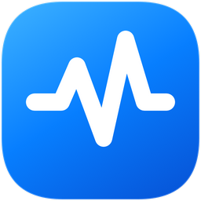

当前源文件：[标记 SVG](../../assets/mark.svg)、[应用 SVG](../../assets/app.svg)、[Windows ICO](../../assets/app.ico)。

## 紧凑布局与事件背景更新

下列为 1320×900 窗口中的实际运行截图，使用测试示例数据。整体字号缩小，首页共用三列网格、上三下二，筛选和刷新合并为工具栏，设置页选择器收短。侧栏恢复 GitHub、静态脱敏账户、监控状态和版本分组。日历通过背景色及分区颜色表示事件，提醒与导出移到工作区顶部。

- [首页与侧栏](16-compact-overview-dark.png)
- [日历事件背景](17-calendar-background-events-dark.png)
- [提醒与导出菜单](18-reminders-menu-dark.png)
- [Token 筛选工具栏](19-token-toolbar-dark.png)

## 日历回退与交互细化

按照后续确认，日历恢复早期的小色块与圆点，月份箭头使用居中 SVG 与圆角方形按钮；主题使用带滑动动画的太阳/月亮 switch。提醒菜单与自定义下拉框首次外部点击仅关闭，不触发后方操作。预测条按概率分级强调，聊天默认选择最近一条并显示读取反馈，顶部工具区压缩间距与控件层次。

- [顶部工具区](20-refined-toolbar-light.png)
- [旧式日历、概率强调与提醒菜单](21-refined-calendar-reminders-light.png)
- [聊天读取反馈（示例数据）](22-chat-loading-light.png)

## 设置页按使用频率分组

常用的监控与提醒、悬浮窗设置放在前面，主题与语言合并为外观分类，连接维护、版本更新及关于放在后面。增加分类导航；窄窗口使用横向分类栏。GitHub 移除侧栏入口，仅在末尾关于区保留轻量链接。

- [设置页浅色截图](23-settings-priority-light.png)
- [窄窗口分类导航及维护区](24-settings-priority-narrow.png)
